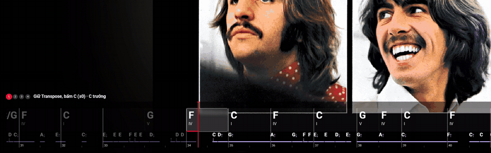
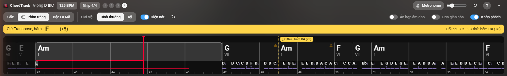

<div align="center">


# ChordTrack

**Hợp âm chạy theo video YouTube, kiểu karaoke. AI chạy ngay trên máy bạn.**

*Live chords for any YouTube video, analyzed 100% locally.*


</div>

---

<p align="center">
  
  <br><sub>🎬 "Magia" (Kalafina, Yuki Kajiura sáng tác): hợp âm và nốt giai điệu chạy theo video ở chế độ toàn màn hình</sub>
</p>

## ✨ Có gì

<table>
<tr>
<td align="center" width="33%">🎼<br><b>Hợp âm thời gian thực</b><br><sub>Nhận cả 7, sus, dim và hợp âm đảo</sub></td>
<td align="center" width="33%">🥁<br><b>Nhịp</b><br><sub>Vạch phách, BPM, metronome khớp bài</sub></td>
<td align="center" width="33%">🗺️<br><b>Cấu trúc bài</b><br><sub>Từng đoạn, vòng hợp âm, giọng</sub></td>
</tr>
<tr>
<td align="center">🎹<br><b>Phím trắng</b><br><sub>Tự transpose cho người chơi piano</sub></td>
<td align="center">🎵<br><b>Dò giai điệu</b><br><sub>Tên nốt và ↑/↓ chạy dưới hợp âm</sub></td>
<td align="center">🖥️<br><b>Toàn màn hình &amp; rạp phim</b><br><sub>Hợp âm hiện ở mọi chế độ xem</sub></td>
</tr>
</table>

🔒 Mọi phân tích chạy trên máy bạn, không gửi gì lên mạng.

## 📸 Giao diện

### Ba cách đọc hợp âm

**🎹 Phím trắng** (mặc định): đổi về giọng chỉ dùng phím trắng, kèm số nút transpose cần bấm. Thanh vàng đếm ngược trước chỗ đổi giọng.


**Gốc**: hợp âm đúng như bản thu, nút Tông −/+ để dịch giọng.


**Bậc La Mã**: hợp âm theo bậc trong giọng (I, IV, V, vi…), để học vòng hợp âm.


> Vạch đỏ là chỗ đang phát · vạch vàng đứt là chỗ đổi giọng · ⚠ là hợp âm model chưa chắc · bấm vào hợp âm để tua tới đó.

### Dò giai điệu



Bấm **♪ Dò giai điệu** khi hợp âm đã hiện. Tên nốt chạy dưới hợp âm, ↑/↓ là cao hay thấp hơn nốt trước. Giọng hát
được tách riêng trước khi dò; nốt tự khớp phách và dịch giọng theo hợp âm. Bài 4 phút mất khoảng 2–3 phút ở lần đầu.

| Cách | Model | Hợp với |
|---|---|---|
| **Bình thường** (mặc định) | YourMT3+ | Bài có lời |
| **Kỹ** (tùy chọn, [cách bật](#5-tùy-chọn-bật-cách-dò-kỹ)) | YourMT3+ và MuScriptor | Bài có đoạn nhạc cụ dài |

### Cấu trúc bài

<table>
<tr>
<td width="45%"></td>
<td>

Cột phải liệt kê **từng đoạn**: vòng hợp âm, bậc La Mã, giọng, nút transpose.

🎨 Cùng màu là cùng đoạn nhạc lặp lại. ⏩ Bấm vào đoạn để tua tới đó.

🎬 Ở **chế độ rạp phim**, các đoạn xếp ngang dưới dải hợp âm (ảnh dưới).

</td>
</tr>
</table>


## 🚀 Cài đặt (Windows)

### Cấu hình máy

| | Tối thiểu | Khuyến nghị | Máy đã thử |
|---|---|---|---|
| 💻 Hệ điều hành | Windows 10 64-bit | Windows 11 | Windows 11 Pro |
| 🧠 RAM | 8 GB | 16 GB | 32 GB |
| 🎮 GPU | Không bắt buộc (chạy CPU, chậm hơn nhiều) | NVIDIA ≥ 4 GB VRAM, driver hỗ trợ CUDA 12.6 | RTX 3060 Ti 8 GB |
| ⚙️ CPU | 64-bit, 4 nhân | 6 nhân trở lên | i5-12400F |
| 💾 Ổ đĩa trống | 10 GB | 20 GB | |
| 🧭 Trình duyệt | Chrome hoặc trình duyệt nhân Chromium | Google Chrome | Google Chrome |

- Cột "Tối thiểu" ước tính từ số đo, chưa thử trên máy yếu. Đo trên máy đã thử: phân tích hợp âm ~16 giây (RAM 2,1 GB,
  VRAM 0,7 GB); dò giai điệu ~2 phút (RAM 3,4 GB, VRAM 3,0 GB).
- GPU dưới 4 GB: dò giai điệu có thể hết VRAM, cài lại với `setup.ps1 -Cpu`.
- Mỗi bài chiếm khoảng 170 MB trong `data\audio` và `data\cache`, xóa được khi cần chỗ.
- Chưa hỗ trợ macOS, Linux.

### 1. Tải mã nguồn và cài

Mở **PowerShell** ở thư mục muốn đặt dự án:

```powershell
git clone https://github.com/MakitJenamin/extension_chordtracking.git
cd extension_chordtracking
powershell -ExecutionPolicy Bypass -File scripts\setup.ps1
```

Script tự cài Python 3.11, PyTorch (bản CUDA nếu có GPU NVIDIA), thư viện, model (kiểm SHA-256), ffmpeg và Deno, rồi
chạy thử và in tóm tắt. Tải khoảng 5 GB, mất khoảng 14 phút với mạng 12 MB/s. Chạy lại nhiều lần không sao.

Tùy chọn: `-Cpu` (PyTorch bản CPU), `-NoMelody` (bỏ dò giai điệu), `-NoTools` (không tự cài ffmpeg, Deno), `-Full` (cho dev).

### 2. Bật server

```powershell
powershell -ExecutionPolicy Bypass -File scripts\start_server.ps1 -Background
```

Server chạy ẩn ở `http://127.0.0.1:8765`, chỉ máy bạn gọi được. Mỗi lần mở máy chạy lại lệnh này. Bỏ `-Background` để
xem log trong cửa sổ.

### 3. Nạp extension vào Chrome (một lần)

1. Mở `chrome://extensions`, bật **Developer mode**.
2. Bấm **Load unpacked**, chọn thư mục `extension` trong thư mục dự án.

### 4. Dùng

Mở video YouTube, bấm nút **ChordTrack** trên thanh điều khiển player (hoặc <kbd>Alt</kbd>+<kbd>Shift</kbd>+<kbd>C</kbd>).
Lần đầu mỗi bài mất 10–20 giây trên GPU, lần sau có ngay. Các nút và phím tắt: [extension/README.md](extension/README.md).

### 5. (Tùy chọn) Bật cách dò Kỹ

Weights MuScriptor theo license CC BY-NC 4.0 (chỉ dùng phi thương mại) và cần tài khoản Hugging Face miễn phí.

1. Tạo token **Read** ở [Hugging Face](https://huggingface.co/settings/tokens), bấm đồng ý điều khoản ở trang
   [MuScriptor/muscriptor-small](https://huggingface.co/MuScriptor/muscriptor-small).
2. Chạy rồi khởi động lại server:
   ```powershell
   .venv\Scripts\hf.exe auth login
   .venv\Scripts\python.exe scripts\fetch_models.py --muscriptor
   ```

**🔄 Cập nhật:** `git pull` → chạy lại `setup.ps1` → khởi động lại server → bấm ↻ ở extension trong `chrome://extensions`.
**🗑️ Gỡ:** xóa extension và thư mục dự án.

## 🛠️ Lỗi thường gặp

<details>
<summary><b>Extension báo "Chưa kết nối được server"</b></summary>

Chạy lại `scripts\start_server.ps1 -Background`. Vẫn lỗi thì xem `data\cache\server.log`. Vừa cập nhật extension thì
tải lại trang YouTube (F5).
</details>

<details>
<summary><b>YouTube báo "not a bot" / "Sign in to confirm"</b></summary>

Xuất cookie YouTube ra `cookies.txt` (extension *Get cookies.txt LOCALLY*), để **ngoài** thư mục dự án, rồi chạy:

```powershell
powershell -ExecutionPolicy Bypass -File scripts\start_server.ps1 -Background -Cookies C:\duong\dan\cookies.txt
```

> [!CAUTION]
> `cookies.txt` là phiên đăng nhập Google của bạn. Không gửi cho ai, nên dùng tài khoản phụ.
</details>

<details>
<summary><b>Thiếu ffmpeg hoặc Deno</b></summary>

Cài tay: `winget install Gyan.FFmpeg` và `winget install DenoLand.Deno`, rồi **mở PowerShell mới** và chạy lại server.
</details>

<details>
<summary><b>Hết VRAM (CUDA out of memory)</b></summary>

Đóng game hay app AI khác đang giữ VRAM rồi bấm Thử lại. GPU nhỏ: cài lại với `setup.ps1 -Cpu`.
</details>

<details>
<summary><b>Nút "Dò giai điệu" hoặc "Kỹ" bị mờ</b></summary>

- "Dò giai điệu" mờ: chưa cài dò giai điệu. Chạy lại `setup.ps1`, xem tóm tắt cuối, khởi động lại server.
- "Kỹ" mờ: chưa bật MuScriptor, xem [bước 5](#5-tùy-chọn-bật-cách-dò-kỹ). Báo 401/403 nghĩa là chưa đăng nhập
  (`hf auth login`) hoặc chưa đồng ý điều khoản trên trang model.
</details>

<details>
<summary><b>Setup báo "Filename too long"</b></summary>

Clone lại vào thư mục ngắn (ví dụ `C:\chordtrack`) hoặc bật `LongPathsEnabled` của Windows rồi chạy lại `setup.ps1`.
</details>

## 🧑‍💻 Phát triển và đóng góp

```powershell
powershell -ExecutionPolicy Bypass -File scripts\setup.ps1 -Full   # thêm thư viện và model để chấm điểm
```

Luôn gọi `.venv\Scripts\python.exe` bằng đường dẫn đầy đủ: lệnh `python` trên Windows có thể là bản giả của Microsoft Store.

### Cấu trúc thư mục

| Thư mục | Nội dung |
|---|---|
| `chordtrack/` | Backend: tải audio, tách nguồn, bắt nhịp, nhận hợp âm (`chords/`), trộn kết quả (`fusion.py`), giọng và cấu trúc (`analysis.py`), dò giai điệu (`melody/`), hàng đợi job, server FastAPI |
| `chordtrack/types.py` | Kiểu dữ liệu dùng chung (`Stems`, `BeatGrid`, `ChordSegment`, `ChordModelOutput`…) |
| `extension/` | Extension Chrome (Manifest V3). `extension/dev/` có harness thử giao diện không cần YouTube |
| `eval/` | Bộ đánh giá hợp âm ([README](eval/README.md)) và giai điệu ([README](eval/melody/README.md)) |
| `scripts/` | Cài đặt, tải model, chạy server, chạy thử |
| `requirements/` | Thư viện theo module; `constraints.txt` ghim phiên bản chung |
| `tests/` | Test pytest |
| `third_party_src/`, `data/` | Model bên thứ ba, weights, audio, cache. **Không nằm trong git** |

### Chạy test

```powershell
.venv\Scripts\python.exe -m pytest -q -m "not gpu"        # nhanh, không cần GPU
.venv\Scripts\python.exe -m pytest -q -m gpu              # chạy model thật
node --test extension\dev\theory.test.js                  # logic hợp âm của extension
.venv\Scripts\python.exe scripts\smoke_test.py --melody   # kiểm tra cài đặt
```

Thử giao diện không cần YouTube: chạy `.venv\Scripts\python.exe extension\dev\serve.py`, mở
`http://127.0.0.1:8770/watch?v=QDYfEBY9NM4`.

### Quy ước

- **Python 3.11, numpy 1.x.** Không nâng numpy lên 2.x: scipy 1.13, ChordMini, Chord-CNN-LSTM và audio-separator cần numpy 1.26.
- Thư viện mới ghi vào `requirements/<module>.txt` của module đó.
- Code chạy model trên GPU nằm trong `with chordtrack.gpu.gpu_lock():`; test cần GPU gắn `@pytest.mark.gpu`.
- Dùng kiểu trong `chordtrack/types.py`, không định nghĩa kiểu trùng.
- Đổi model hay tham số trộn thì chấm lại bằng `eval/` và ghi số trước/sau vào PR.
- **Repo public:** không commit audio, weights, cookie hay dữ liệu có bản quyền.

### Gửi đóng góp

Thay đổi lớn thì mở issue trước. Tạo nhánh từ `main`, chạy test, mở pull request kèm mô tả thay đổi và kết quả test
(tiếng Việt hay tiếng Anh đều được). Báo lỗi qua [GitHub Issues](https://github.com/MakitJenamin/extension_chordtracking/issues),
kèm videoId và `data\cache\server.log`.

<details>
<summary><b>📡 API backend</b></summary>

Server FastAPI, chỉ nghe `127.0.0.1:8765` (đổi bằng `-Port`). CORS chỉ cho `chrome-extension://*` và `https://www.youtube.com`. Một worker xử lý lần lượt, hàng đợi ở `data/cache/jobs.sqlite`.

| Endpoint | Mô tả |
|---|---|
| `GET /health` | Trạng thái server, GPU, hàng đợi, ffmpeg, Deno, cookies, các cách dò giai điệu chạy được |
| `POST /analyze` | `{"source": "<videoId hoặc URL>", "force": false}` → kết quả nếu đã cache, không thì `job_id` |
| `GET /jobs/{job_id}` | `status`, `progress`, `step`, `eta_seconds`, `error` |
| `GET /result/{song_id}` | JSON kết quả (header `X-Chordtrack-Stale: 1` nếu do mã cũ tạo) |
| `GET /songs` | Danh sách bài đã phân tích |
| `POST /melody` | Dò giai điệu; `"model": "combo"` (Kỹ) hoặc `"yourmt3"` (Bình thường), `"vocals": true` để tách giọng trước. Chi tiết: [docs/melody_api.md](docs/melody_api.md) |
| `GET /melody/{song_id}?model=combo\|yourmt3&vocals=0\|1` | Dòng nốt (`start`, `end`, `pitch` MIDI, `confidence`, `uncertain`, `source`) |

```powershell
Invoke-RestMethod -Method Post http://127.0.0.1:8765/analyze -ContentType application/json -Body '{"source": "QDYfEBY9NM4"}'
```

</details>

## 🙏 Cảm ơn

- **Nhận hợp âm:** [ChordMini](https://github.com/ptnghia-j/ChordMini) (Nghia Phan và cộng sự),
  [Chord-CNN-LSTM](https://github.com/ptnghia-j/chord-cnn-lstm-model) (Junyan Jiang và cộng sự, Music X Lab),
  [ChordFormer](https://github.com/mwaseemrandhawa/ChordFormer) (Akram, Dettori, Colla, Buttazzo).
- **Bắt nhịp:** [Beat This!](https://github.com/CPJKU/beat_this) (Foscarin, Schlüter, Widmer, CPJKU).
- **Dò giai điệu:** [YourMT3+](https://huggingface.co/spaces/mimbres/YourMT3) (Chang, Dixon, Benetos),
  [MuScriptor](https://github.com/muscriptor/muscriptor) (Kyutai và Mirelo).
- **Tách nguồn:** BS-Roformer và HTDemucs qua [audio-separator](https://github.com/nomadkaraoke/python-audio-separator).
- **Tải audio:** [yt-dlp](https://github.com/yt-dlp/yt-dlp). **Đánh giá:** nhãn hợp âm của [Isophonics](http://isophonics.net/).

## 📜 License

Mã dự án: [MIT](LICENSE). Model bên thứ ba giữ license của tác giả, xem [THIRD_PARTY.md](THIRD_PARTY.md).

- ⚠️ Weights MuScriptor (cách dò Kỹ): CC BY-NC 4.0, chỉ dùng phi thương mại.
- ⚠️ ChordFormer không có license, THIRD_PARTY.md hướng dẫn cách tắt.
- ⚠️ Server dùng yt-dlp tải audio từ YouTube, việc này có thể trái [điều khoản YouTube](https://www.youtube.com/t/terms).
  Chỉ dùng cho cá nhân và đừng chia sẻ lại các file đó.

<div align="center"><sub>Kế hoạch, quyết định và số đo chất lượng: <a href="PLAN.md">PLAN.md</a></sub></div>
