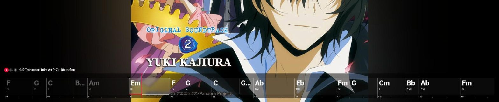
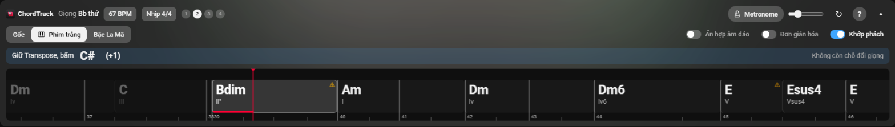
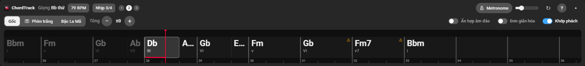
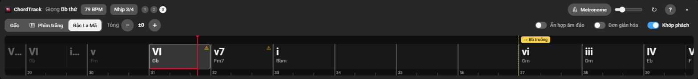
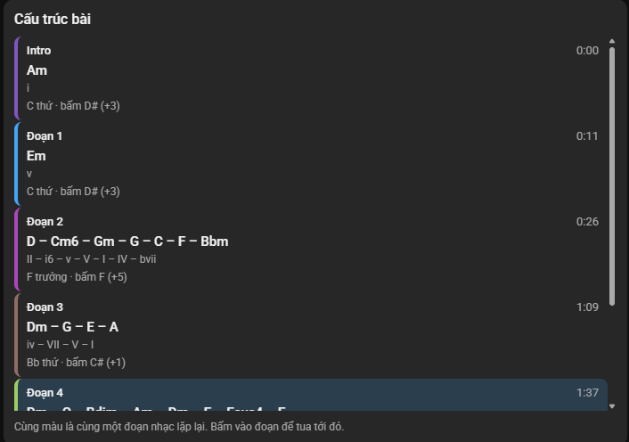
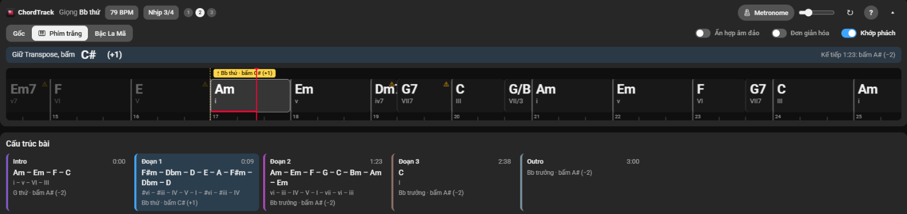

<div align="center">


# ChordTrack

**Hợp âm chạy theo video YouTube, kiểu karaoke. AI chạy ngay trên máy bạn.**

*Live chords for any YouTube video, analyzed 100% locally.*


</div>

---

<p align="center">
  
  <br><sub>🖥️ Toàn màn hình: dải hợp âm đè lên video, ngay trên thanh điều khiển, chữ luôn rõ để vừa xem vừa đàn</sub>
</p>

## ✨ Có gì

<table>
<tr>
<td align="center" width="33%">🎼<br><b>Hợp âm thời gian thực</b><br><sub>Nhận cả 7, sus, dim và hợp âm đảo</sub></td>
<td align="center" width="33%">🥁<br><b>Nhịp</b><br><sub>Vạch phách, BPM, metronome khớp bài</sub></td>
<td align="center" width="33%">🗺️<br><b>Cấu trúc bài</b><br><sub>Từng đoạn, vòng hợp âm, giọng</sub></td>
</tr>
<tr>
<td align="center">🎹<br><b>Phím trắng</b><br><sub>Tự transpose cho người chơi piano</sub></td>
<td align="center">🖥️<br><b>Toàn màn hình &amp; rạp phim</b><br><sub>Hợp âm hiện ở mọi chế độ xem</sub></td>
<td align="center">🔒<br><b>Riêng tư</b><br><sub>AI chạy trên máy, không gửi gì đi</sub></td>
</tr>
<tr>
<td align="center">🎵<br><b>Dòng giai điệu</b><br><sub>Bấm "Dò giai điệu": tên nốt và ↑/↓ chạy dưới hợp âm, dịch giọng như hợp âm</sub></td>
<td></td><td></td>
</tr>
</table>

## 📸 Giao diện

### Ba cách đọc hợp âm

**🎹 Phím trắng** (mặc định): đổi hợp âm về giọng chỉ dùng phím trắng, kèm số nút transpose cần bấm trên đàn. Thanh vàng đếm ngược trước chỗ đổi giọng.



**Gốc**: hợp âm đúng như bản thu, nút Tông −/+ để dịch giọng tự do.



**Bậc La Mã**: hợp âm theo bậc trong giọng (I, IV, V, vi…), hợp để học vòng hợp âm và chơi ở giọng bất kỳ.



> Vạch đỏ là chỗ đang phát · vạch vàng đứt là chỗ đổi giọng · ⚠ là hợp âm model chưa chắc · bấm vào hợp âm để tua tới đó.

### Cấu trúc bài

<table>
<tr>
<td width="45%"></td>
<td>

Cột phải liệt kê **từng đoạn** của bài: vòng hợp âm, bậc La Mã, giọng và nút transpose.

🎨 Cùng màu là cùng một đoạn nhạc lặp lại.

⏩ Bấm vào đoạn để tua tới đó.

🎬 Ở **chế độ rạp phim**, các đoạn xếp ngang ngay dưới dải hợp âm (ảnh dưới).

</td>
</tr>
</table>



## 🚀 Cài đặt (Windows)

> Cần Chrome, ~10 GB trống. Có GPU NVIDIA thì 10–20 giây/bài, CPU ~1 phút.

```powershell
git clone https://github.com/MakitJenamin/extension_chordtracking.git
cd extension_chordtracking
powershell -ExecutionPolicy Bypass -File scripts\setup.ps1   # 10–20 phút lần đầu
```

Script tự cài Python, PyTorch, model, ffmpeg, Deno. Tùy chọn: `-Cpu`, `-Full`, `-Melody`, `-NoTools`.

**🎵 Dò giai điệu (tùy chọn, `-Melody`):** thêm YourMT3+ và MuScriptor small (khoảng 1 GB, mỗi bài 2–3 phút trên GPU).
Trong panel chọn được **"Ghép"** (mặc định: YourMT3+ ở đoạn hát, MuScriptor small ở phần còn lại, tốt hơn với nhạc
không lời) hoặc **"Chỉ YourMT3+"** (khoảng 40 giây cho bài 4 phút, bắt giọng hát tốt bằng hoặc hơn, kém ở đoạn dàn
nhạc). Bài đã dò bằng một cách thì cách kia không phải chạy lại YourMT3+.
Weights MuScriptor theo license **CC BY-NC 4.0 (chỉ dùng phi thương mại)** và để ở repo gated trên Hugging Face, nên
cần tài khoản Hugging Face. Sau khi chạy `setup.ps1` như trên:

```powershell
.venv\Scripts\hf.exe auth login        # dán access token (quyền read) tạo ở huggingface.co/settings/tokens
# mở https://huggingface.co/MuScriptor/muscriptor-small, đăng nhập và bấm đồng ý điều khoản
powershell -ExecutionPolicy Bypass -File scripts\setup.ps1 -Melody
```

Đã cài rồi thì chỉ cần `.venv\Scripts\python.exe scripts\fetch_models.py --melody`. `GET /health` trả `"melody": true`
khi đủ model.

> [!WARNING]
> Script tải mã và weights của bên thứ ba ([THIRD_PARTY.md](THIRD_PARTY.md)). Weights đã ghim commit và kiểm SHA-256, đừng thay bằng file lạ.

## 🎶 Dùng

1. **Bật server** (mỗi lần mở máy)
   ```powershell
   powershell -ExecutionPolicy Bypass -File scripts\start_server.ps1 -Background
   ```
2. **Nạp extension** (một lần): `chrome://extensions` → bật *Developer mode* → *Load unpacked* → chọn thư mục `extension`.
3. **Mở YouTube**, bấm nút ChordTrack trên player hoặc <kbd>Alt</kbd>+<kbd>Shift</kbd>+<kbd>C</kbd>.

Các nút trong extension: [extension/README.md](extension/README.md).

> [!CAUTION]
> Server dùng [yt-dlp](https://github.com/yt-dlp/yt-dlp) tải audio về `data/audio/`, việc này có thể trái [điều khoản YouTube](https://www.youtube.com/t/terms). Bạn tự chịu trách nhiệm, đừng chia sẻ lại các file đó.

**🔄 Cập nhật:** `git pull` → chạy lại `setup.ps1` → tải lại extension.  **🗑️ Gỡ:** xóa extension và thư mục repo.

## 🛠️ Sự cố

**YouTube báo "not a bot"** → xuất cookie ra `cookies.txt` (extension *Get cookies.txt LOCALLY*), chạy server thêm `-Cookies <đường dẫn>`.

> [!CAUTION]
> `cookies.txt` là phiên đăng nhập Google của bạn. Không gửi cho ai, để ngoài thư mục repo, nên dùng tài khoản phụ.

<details>
<summary><b>📡 API backend</b> (cho dev)</summary>

Server FastAPI, chỉ nghe `127.0.0.1:8765` (đổi bằng `-Port`). CORS chỉ cho `chrome-extension://*` và `https://www.youtube.com`. Một worker xử lý lần lượt, hàng đợi ở `data/cache/jobs.sqlite`, log ở `data/cache/server.log`.

| Endpoint | Mô tả |
|---|---|
| `GET /health` | Trạng thái server, GPU, hàng đợi, ffmpeg, Deno, cookies |
| `POST /analyze` | `{"source": "<videoId hoặc URL>", "force": false}` → kết quả nếu đã cache, không thì `job_id` |
| `GET /jobs/{job_id}` | `status`, `progress`, `step`, `eta_seconds`, `error` |
| `GET /result/{song_id}` | JSON kết quả (header `X-Chordtrack-Stale: 1` nếu do mã cũ tạo) |
| `GET /songs` | Danh sách bài đã phân tích |
| `POST /melody` | Dò giai điệu, giống `/analyze`; `"model": "combo"` (mặc định, job `kind: "melody"`) hoặc `"yourmt3"` (job `melody_yourmt3`); hợp đồng ở [docs/melody_api.md](docs/melody_api.md) |
| `GET /melody/{song_id}?model=combo\|yourmt3` | Dòng nốt giai điệu (`notes`: `start`, `end`, `pitch` MIDI, `confidence`, `uncertain`, `source`) |

```powershell
Invoke-RestMethod -Method Post http://127.0.0.1:8765/analyze -ContentType application/json -Body '{"source": "QDYfEBY9NM4"}'
```

</details>

## 📜 License

Mã dự án: [MIT](LICENSE). Model hợp âm, bắt nhịp và dò giai điệu thuộc tác giả gốc, xem [THIRD_PARTY.md](THIRD_PARTY.md).
⚠️ Weights MuScriptor (dò giai điệu) theo CC BY-NC 4.0: chỉ dùng phi thương mại.
⚠️ ChordFormer không có license, THIRD_PARTY.md hướng dẫn cách tắt.

<div align="center"><sub>Kế hoạch, quyết định và số đo chất lượng: <a href="PLAN.md">PLAN.md</a></sub></div>
